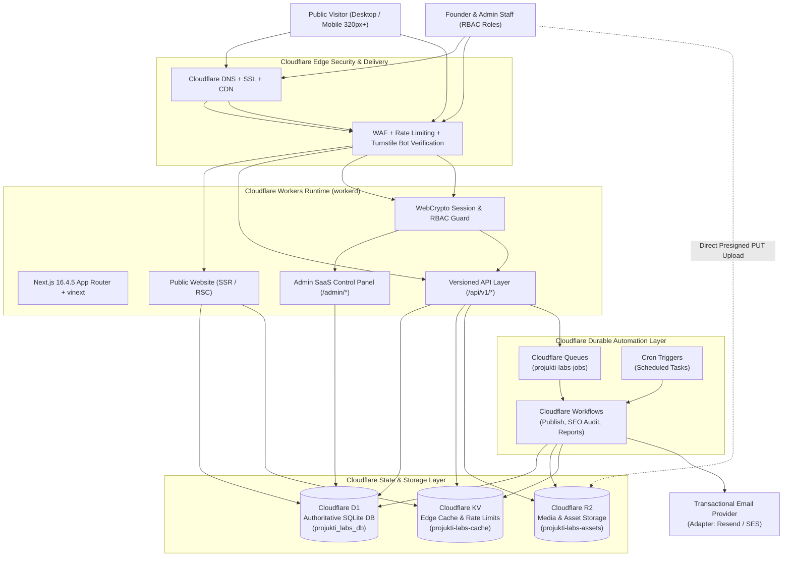
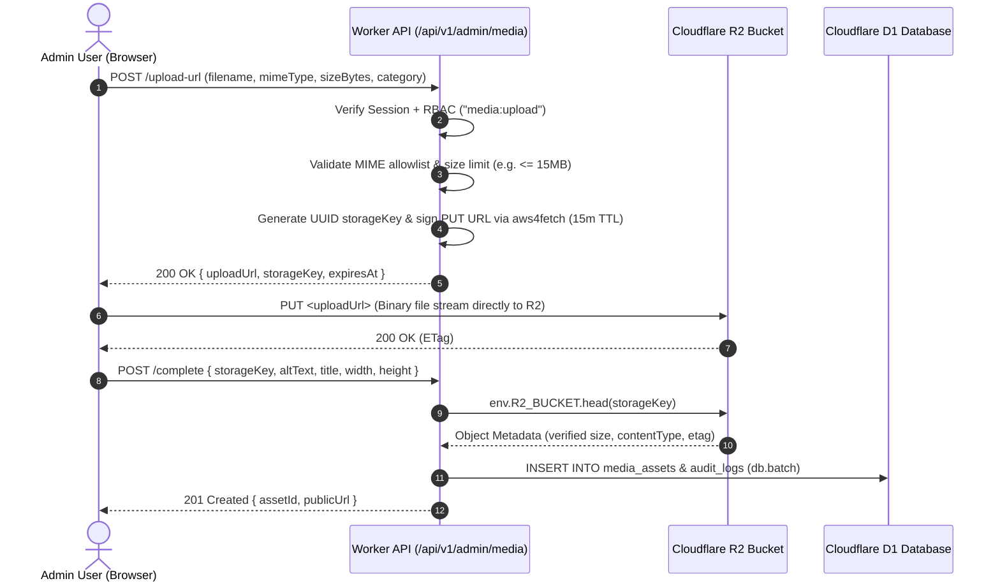
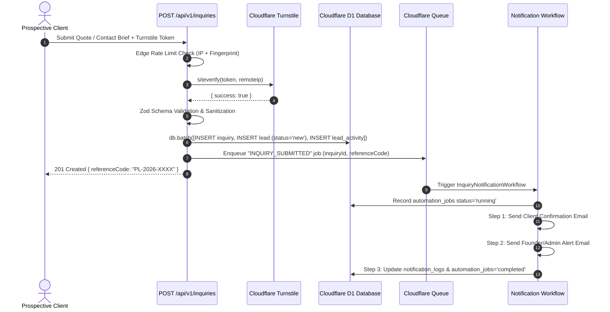
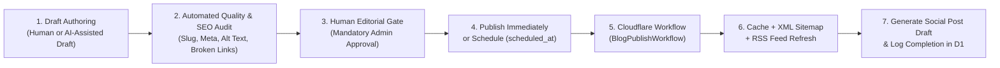

# 05 — Architecture Overview

**Project:** Projukti Labs (`projuktilabs.tech`)  
**Architectural Pattern:** Single-Repository Modular Monolith on Cloudflare Edge  
**Database Pattern:** Single-Business, Single Authoritative Cloudflare D1 Database  

---

## 1. System Context Diagram

Projukti Labs runs entirely at the Cloudflare Edge, minimizing network hops, eliminating egress costs, and keeping all compute, relational data, object storage, caching, and durable workflows inside a single unified platform boundary.

---

## 2. Modular Monolith Application Architecture

Rather than scattering database queries inside React components or building microservices, the codebase enforces a strict **3-tier internal layering**:

1. **Presentation & Routing Layer (`app/`, `components/`):**
   - `app/(public)/*`: Server Components by default; fetches read models via Domain Module Services; renders tailored page compositions.
   - `app/admin/*`: Protected by middleware + server-side RBAC session verification; provides CMS and CRM management views.
   - `app/api/v1/*`: Versioned HTTP endpoints for public inquiries, auth, admin mutations, media upload signing, and internal workflow triggers.
2. **Domain Modules Layer (`modules/*`):**
   - Encapsulates all business logic, Zod input schemas, authorization assertions, cache invalidation calls, and Drizzle queries per bounded domain (`auth`, `services`, `portfolio`, `blog`, `inquiries`, `crm`, `maintenance`, `media`, `seo`, `notifications`, `automation`, `cms`).
3. **Infrastructure & Platform Layer (`lib/*`, `db/*`, `workflows/*`):**
   - `lib/db`: Per-request Drizzle D1 client factory (`getDb(env.DB)`).
   - `lib/cloudflare`: Binding accessors for R2, KV, Queues, Workflows, and Turnstile verification.
   - `lib/auth`: Session token hashing, cookie serialization, and permission evaluation.
   - `lib/cache`: Unified read-through cache helper (Cloudflare Cache API + KV fallback) and tag/key invalidation.

---

## 3. Core Data-Flow Diagrams

### 3.1 Secure Direct-to-R2 Media Upload Flow

Binary files never pass through D1, and large uploads never buffer inside Worker memory:

---

### 3.2 Client Inquiry to CRM Lead Pipeline Flow

---

### 3.3 Automated Blog Publishing & SEO Pipeline Flow

