# 08 — Database Relationship Overview, Integrity & Migration Strategy

**Database:** Cloudflare D1 (`projukti_labs_db`)  
**ORM:** Drizzle ORM (`0.45.4`) + `drizzle-kit` (`0.31.11`)  

---

## 1. Entity Relationship Diagram (Core Domain Overview)

```mermaid
erDiagram
    USERS ||--o{ SESSIONS : "has active"
    USERS }o--|| ROLES : "assigned to"
    ROLES ||--o{ ROLE_PERMISSIONS : "grants"
    PERMISSIONS ||--o{ ROLE_PERMISSIONS : "included in"
    USERS ||--o{ AUDIT_LOGS : "records"

    SERVICE_CATEGORIES ||--o{ SERVICES : "classifies"
    SERVICES ||--o{ SERVICE_PACKAGES : "offers"
    SERVICES ||--o{ SERVICE_FEATURES : "delivers"
    SERVICE_PACKAGES ||--o{ SERVICE_FEATURES : "includes"
    SERVICES ||--o{ SERVICE_FAQS : "answers"
    SERVICES ||--o{ SERVICE_MEDIA : "displays"

    PROJECT_CATEGORIES ||--o{ PROJECTS : "groups"
    PROJECTS ||--o{ PROJECT_MEDIA : "showcases"
    PROJECTS ||--o| CASE_STUDIES : "expands into"
    PROJECTS ||--o{ PROJECT_SERVICES : "demonstrates"
    SERVICES ||--o{ PROJECT_SERVICES : "featured in"

    AUTHORS ||--o{ POSTS : "writes"
    POST_CATEGORIES ||--o{ POSTS : "categorizes"
    POSTS ||--o{ POST_TAGS : "tagged with"
    TAGS ||--o{ POST_TAGS : "applied to"
    POSTS ||--o{ POST_REVISIONS : "versions"
    USERS ||--o{ POSTS : "approves (approved_by_user_id)"

    INQUIRIES ||--o| LEADS : "generates"
    CLIENTS ||--o{ LEADS : "associated with"
    LEADS ||--o{ LEAD_NOTES : "contains"
    LEADS ||--o{ LEAD_ACTIVITIES : "tracks"
    LEADS ||--o{ FOLLOW_UPS : "schedules"
    LEADS ||--o{ PROPOSALS : "quoted via"

    MEDIA_ASSETS ||--o{ SERVICES : "hero image"
    MEDIA_ASSETS ||--o{ PROJECTS : "featured media"
    MEDIA_ASSETS ||--o{ POSTS : "featured image"
    SEO_METADATA ||--o| SERVICES : "optimizes"
    SEO_METADATA ||--o| PROJECTS : "optimizes"
    SEO_METADATA ||--o| POSTS : "optimizes"

    AUTOMATION_JOBS ||--o{ AUTOMATION_LOGS : "emits"
```

---

## 2. Referential Integrity & Foreign Key Cascade Matrix

Cloudflare D1 enforces `PRAGMA foreign_keys = ON` at runtime. Every relationship uses an explicit `ON DELETE` rule designed to prevent accidental loss of business-critical records:

| Parent Table | Child Table | Foreign Key Column | `ON DELETE` Action | Rationale |
|---|---|---|---|---|
| `users` | `sessions` | `user_id` | `CASCADE` | Deleting a user immediately invalidates all sessions. |
| `users` | `audit_logs`, `posts` (`approved_by`) | `actor_user_id`, `approved_by_user_id` | `SET NULL` | Audit trails and published posts must survive staff turnover. |
| `service_categories` | `services` | `category_id` | `RESTRICT` | Cannot delete a category that still owns services. |
| `services` | `service_packages`, `service_features`, `service_faqs` | `service_id` | `CASCADE` | Sub-items belong exclusively to their parent service. |
| `services` | `inquiries` | `service_id` | `SET NULL` | Historical client inquiries must remain intact if a service is retired. |
| `projects` | `case_studies` | `project_id` | `SET NULL` | Case studies can stand alone even if portfolio item changes. |
| `post_categories`, `authors` | `posts` | `category_id`, `author_id` | `RESTRICT` | Prevents orphaned articles without an author or category. |
| `posts` | `post_revisions`, `post_tags`, `post_media` | `post_id` | `CASCADE` | Revisions and join rows clean up when a draft is permanently purged. |
| `inquiries` | `leads` | `inquiry_id` | `SET NULL` | Lead pipeline survives raw inquiry archival. |
| `leads` | `lead_notes`, `lead_activities`, `follow_ups` | `lead_id` | `CASCADE` | Sub-records belong strictly to the lead lifecycle. |
| `media_assets` | `services`, `projects`, `posts`, `seo_metadata` | `*_media_id` | `SET NULL` | Replacing or deleting an image must never delete an article or service. |
| `automation_jobs` | `automation_logs` | `job_id` | `CASCADE` | Step logs are pruned alongside old job records. |

---

## 3. Soft Deletion vs. Hard Deletion Policy

| Entity Group | Deletion Policy | Mechanism & URL Redirect Rule |
|---|---|---|
| **Public SEO Entities** (`services`, `projects`, `case_studies`, `posts`) | **Soft Delete (`deleted_at` + `status = 'archived'`)** | Preserves historical foreign keys and allows automatic creation of a `301` or `410` rule in `redirects` so indexed URLs do not silently break. |
| **Business & Audit Entities** (`inquiries`, `leads`, `clients`, `audit_logs`) | **No Public Delete (Archive Only; GDPR Erasure via Admin Tool)** | Business inquiries and security audit logs are immutable in normal operations. |
| **Ephemeral / Join Entities** (`sessions`, `post_tags`, `role_permissions`, `login_attempts`) | **Hard Delete** | Safe to remove directly or prune via scheduled maintenance jobs. |

---

## 4. Slug Uniqueness & URL Strategy

1. **Deterministic Normalization:** Slugs are lowercase ASCII alphanumeric with hyphens (`/^[a-z0-9]+(?:-[a-z0-9]+)*$/`). Bangla titles automatically transliterate or require an explicit English SEO slug (`slug`) for clean international URLs.
2. **Slug Change Redirect Hook:** Whenever a `published` service, project, or blog post changes its `slug`, the domain service atomically inserts `{ source_path: oldPath, destination_url: newPath, status_code: 301 }` into the `redirects` table inside the same `db.batch()` call.

---

## 5. Migration Naming, Seed Strategy & Backup/Recovery Plan

### 5.1 Migration Workflow (`db/migrations/`)
- Migrations are generated via `pnpm drizzle-kit generate` and stored in `db/migrations/NNNN_<descriptive_snake_case_name>.sql` (e.g., `0000_initial_core_schema.sql`).
- When altering tables with foreign keys in SQLite/D1, migrations must include `PRAGMA defer_foreign_keys = ON;` at the start of the transaction block.
- **Zero Auto-Migrate in Production App Boot:** Migrations are executed explicitly via CI/CD (`wrangler d1 migrations apply projukti_labs_db --remote`) **after** taking a pre-migration Time Travel bookmark check.

### 5.2 Idempotent Seed Strategy (`db/seeds/`)
- Initial seed script (`db/seeds/initial.ts`) uses `INSERT ... ON CONFLICT (slug) DO UPDATE` to populate:
  - The 5 RBAC Roles (`super_admin`, `admin`, `editor`, `manager`, `support`) and granular permissions.
  - The **3 Active Launch Service Categories** (`web-development`, `ecommerce`, `maintenance-support`) with `availability_mode = 'active'`.
  - The **7 Future Service Categories** with `availability_mode = 'coming_soon'`.
  - The Initial Productized Services (`/services/landing-page-facebook-pixel`, `/services/complete-ecommerce-website`, `/services/business-website`, etc.) and 4 Maintenance Care Tiers.
  - Default Founder Author profile (`Md Parvezul Islam`).

### 5.3 Backup & Disaster Recovery Strategy (D1 + R2)
1. **D1 Time Travel (Continuous PITR):** Built-in minute-granularity recovery for 30 days (`wrangler d1 time-travel restore projukti_labs_db --timestamp=...`).
2. **Scheduled SQL Dump Export to R2:** Weekly Cloudflare Workflow runs `D1 export` (or table snapshot export) and stores encrypted `.sql.gz` backups inside a private R2 prefix (`backups/d1/YYYY-MM-DD/`).
3. **R2 Object Protection:** R2 bucket versioning / object lock + lifecycle rule preventing unauthenticated deletion; deleting a `media_assets` row marks it for delayed R2 garbage collection (7-day grace window) rather than instant destructive purge.

