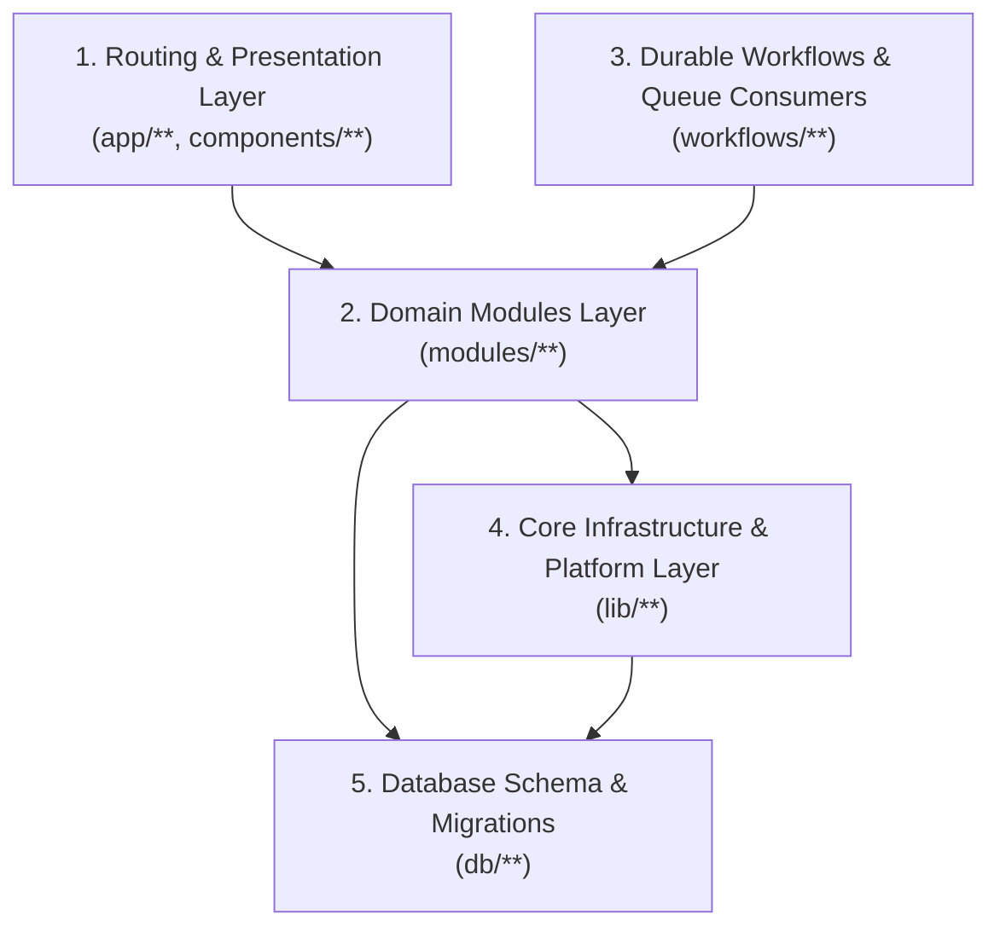

# 11 — Module Boundaries and Folder Structure

**Architectural Style:** Modular Monolith with Strict Unidirectional Dependencies  
**Workspace Root:** `/Users/parvez/CODE/projukti_labs`

---

## 1. Dependency Direction Rules

To keep the codebase clean, testable, and free of circular dependencies over multi-year operation:



### Strict Boundary Rules:
1. **No Raw Drizzle Queries in `app/` or `components/`:** React Server Components, Client Components, and Route Handlers must never import `db/schema` directly to write ad-hoc SQL queries. They call typed functions exported by `modules/<domain>/index.ts`.
2. **Cross-Module Communication:** Domain modules communicate only through their public `index.ts` service interfaces (for example, `inquiries` calls `crm.createLeadFromInquiry(...)` inside a shared `db.batch()` context, and `automation.enqueueJob(...)`).
3. **Validation at the Boundary:** Every public or admin mutation validates its input via the domain module's `schemas.ts` (Zod) before executing business logic.

---

## 2. Domain Module Responsibilities (`modules/*`)

| Module | Public Interface (`modules/<name>/index.ts`) | Owned Database Tables | Key Responsibilities |
|---|---|---|---|
| `auth` | `login`, `logout`, `getCurrentSession`, `requirePermission`, `recordAuditLog` | `users`, `sessions`, `roles`, `permissions`, `role_permissions`, `login_attempts`, `audit_logs` | Session token hashing, RBAC enforcement, brute-force protection, security audit trail. |
| `services` | `listCategories`, `listPublicServices`, `getServiceBySlug`, `upsertService`, `publishService` | `service_categories`, `services`, `service_packages`, `service_features`, `service_faqs`, `service_media`, `service_technologies` | Enforces 3 active vs. 7 coming-soon categories; manages productized packages and `layout_variant` configurations. |
| `portfolio` | `listProjects`, `getProjectBySlug`, `listCaseStudies`, `getCaseStudyBySlug`, `upsertProject` | `projects`, `project_categories`, `project_media`, `case_studies`, `project_services` | Project showcase filtering, gallery ordering, and verified case-study storytelling. |
| `blog` | `listPublishedPosts`, `getPostBySlug`, `saveDraft`, `runContentAudit`, `approveAndPublish`, `schedulePost` | `posts`, `post_categories`, `tags`, `post_tags`, `authors`, `post_revisions`, `post_media`, `post_related` | Editorial state machine (`draft` → `in_review` → `approved` → `published`), reading time calculation, revision history, and human-approval enforcement. |
| `inquiries` | `submitPublicInquiry`, `getInquiryStatusByRef`, `listAdminInquiries` | `inquiries` | Turnstile verification, reference code generation (`PL-YYYY-XXXX`), rate-limit coordination, and atomic handoff to `crm`. |
| `crm` | `createLeadFromInquiry`, `updateLeadStage`, `addLeadNote`, `scheduleFollowUp`, `convertLeadToClient` | `leads`, `lead_notes`, `lead_activities`, `follow_ups`, `clients`, `proposals` | Lead pipeline tracking (`new` → `won`/`lost`), follow-up scheduling, and activity timeline logging. |
| `maintenance` | `listMaintenancePlans`, `createSupportTicket`, `replyToTicket` | `maintenance_plans`, `subscriptions`, `support_tickets`, `support_messages` | Care package SLA display (`Basic`, `Business`, `Priority`, `Custom`) and client support ticket operations. |
| `media` | `createPresignedUploadUrl`, `confirmUploadComplete`, `listMediaAssets`, `deleteMediaAsset` | `media_assets` | `aws4fetch` S3 presigned URL signing, R2 `.head()` verification, and alt-text enforcement. |
| `cms` | `getHomepageSections`, `updateHomepageSections`, `getPublicSiteSettings`, `getNavigation` | `site_settings`, `pages`, `page_sections`, `navigation_items` | Structured Homepage Section Builder, global navigation, and site configuration. |
| `seo` | `resolvePageMetadata`, `buildJsonLd`, `generateXmlSitemap`, `checkRedirects`, `runSeoAudit` | `seo_metadata`, `redirects` | Dynamic Next.js `Metadata` generation, JSON-LD schema builders, 301 redirect lookup, and automated SEO auditing. |
| `notifications` | `sendTransactionalEmail`, `renderEmailTemplate` | `notification_logs` | Adapter-based email dispatch (inquiry confirmation, admin lead alert, follow-up reminder, password reset) with delivery logging. |
| `automation` | `enqueueJob`, `recordJobStart`, `recordJobStep`, `recordJobCompletion`, `retryFailedJob` | `automation_jobs`, `automation_logs`, `scheduled_tasks` | Unified observability, idempotency checking, and retry control for Cloudflare Workflows, Queues, and Cron jobs. |

---

## 3. Complete Target Repository Folder Structure

```text
/Users/parvez/CODE/projukti_labs/
├── app/
│   ├── (public)/                         # Public Studio & Portfolio Website (Server-First)
│   │   ├── layout.tsx                    # Public header, footer, mobile bottom nav
│   │   ├── page.tsx                      # Homepage (Editorial + Structured Sections)
│   │   ├── about/page.tsx                # About Projukti Labs
│   │   ├── founder/page.tsx              # Founder Profile (Md Parvezul Islam)
│   │   ├── services/
│   │   │   ├── page.tsx                  # Active Services Overview + Coming Soon Matrix
│   │   │   ├── category/[slug]/page.tsx  # Service Category Page
│   │   │   └── [slug]/page.tsx           # Dynamic Productized Service Page (switches layout by layout_variant)
│   │   ├── maintenance/page.tsx          # Maintenance Plans & Support SLA Experience
│   │   ├── pricing/page.tsx              # Transparent Pricing & Engagement Models (BDT/USD)
│   │   ├── process/page.tsx              # Engineering & Delivery Process
│   │   ├── portfolio/
│   │   │   ├── page.tsx                  # Visual Project Showcase
│   │   │   └── [slug]/page.tsx           # Project Detail
│   │   ├── case-studies/
│   │   │   ├── page.tsx                  # Case Studies Index
│   │   │   └── [slug]/page.tsx           # Editorial Case Study
│   │   ├── blog/
│   │   │   ├── page.tsx                  # Magazine / Editorial Blog Listing
│   │   │   ├── [slug]/page.tsx           # Reading-focused Article View
│   │   │   ├── category/[slug]/page.tsx  # Blog Category View
│   │   │   └── tag/[slug]/page.tsx       # Blog Tag View
│   │   ├── contact/page.tsx              # Minimal Conversion Contact Page
│   │   ├── get-a-quote/page.tsx          # Guided Project Brief & Quotation Form
│   │   ├── faq/page.tsx                  # Categorized Studio FAQs
│   │   ├── privacy-policy/page.tsx       # Privacy Policy
│   │   └── terms/page.tsx                # Terms of Service
│   │
│   ├── admin/                            # Protected SaaS Admin Control Center
│   │   ├── layout.tsx                    # Admin Sidebar, Topbar, RBAC Session Guard
│   │   ├── login/page.tsx                # Admin Login + Turnstile
│   │   ├── dashboard/page.tsx            # KPI Overview, Recent Inquiries, Job Health
│   │   ├── cms/                          # Homepage Builder, Pages, Navigation, Settings
│   │   ├── services/                     # Categories, Active/Future Services, Packages, FAQs
│   │   ├── portfolio/                    # Projects & Case Studies Manager
│   │   ├── blog/                         # MDX Editor, Approvals, Schedule, SEO Audit
│   │   ├── inquiries/                    # Raw Client Submissions
│   │   ├── crm/                          # Leads Kanban, Follow-ups, Clients, Proposals
│   │   ├── maintenance/                  # Care Plans & Support Tickets
│   │   ├── media/                        # R2 Media Library & Upload Manager
│   │   ├── marketing/                    # Global SEO, Redirects, Newsletter
│   │   └── system/                       # Admin Users, Roles, Audit Logs, Automation Logs
│   │
│   ├── api/
│   │   └── v1/                           # Versioned REST API Route Handlers
│   │       ├── services/
│   │       ├── service-categories/
│   │       ├── projects/
│   │       ├── case-studies/
│   │       ├── blog/
│   │       ├── site/
│   │       ├── search/
│   │       ├── inquiries/
│   │       ├── consultation-requests/
│   │       ├── newsletter/
│   │       ├── auth/
│   │       ├── admin/
│   │       └── internal/
│   │
│   ├── sitemap.ts                        # Dynamic XML Sitemap Generator
│   ├── robots.ts                         # Dynamic robots.txt Generator
│   ├── not-found.tsx                     # Custom Dark-Mode 404 Page
│   ├── globals.css                       # Design Tokens & Tailwind CSS v4 Configuration
│   └── layout.tsx                        # Root HTML Shell & Font Variables
│
├── components/
│   ├── ui/                               # Core Design System Primitives (Button, Card, Dialog, Input, Badge)
│   ├── layout/                           # Header, Footer, MobileBottomNav, StickyMobileCTA, Container
│   ├── homepage/                         # Structured Homepage Sections
│   ├── services/                         # Distinct Service Layout Templates (PixelFunnel, EcommerceShowcase, WebConversion, MaintenancePlans)
│   ├── portfolio/                        # Project Cards, Device Mockups, Case Study Callouts
│   ├── blog/                             # Article Reader, TOC, AuthorCard, CodeBlock
│   ├── forms/                            # QuoteForm, ContactForm, TurnstileWidget
│   └── admin/                            # DataTables, KanbanBoard, SectionBuilder, MediaPicker, MdxEditor
│
├── modules/                              # Bounded Domain Logic (12 Modules)
│   ├── auth/
│   ├── services/
│   ├── portfolio/
│   ├── blog/
│   ├── inquiries/
│   ├── crm/
│   ├── maintenance/
│   ├── media/
│   ├── cms/
│   ├── seo/
│   ├── notifications/
│   └── automation/
│
├── lib/                                  # Shared Technical Infrastructure
│   ├── db/                               # Drizzle client factory & batch chunking helpers
│   ├── cloudflare/                       # Env bindings, R2 aws4fetch signer, Turnstile verifier
│   ├── auth/                             # WebCrypto PBKDF2/SHA-256 & cookie utilities
│   ├── validation/                       # Common Zod primitives & API envelope builders
│   ├── cache/                            # Cloudflare Cache API + KV wrapper
│   ├── seo/                              # JSON-LD schema builders
│   └── utils/                            # Formatting (BDT/USD currency, dates, slugs)
│
├── workflows/                            # Cloudflare Workflows & Queue Consumers
│   ├── blog-publishing/
│   ├── seo-audit/
│   ├── image-processing/
│   ├── notifications/
│   └── maintenance/
│
├── db/
│   ├── schema/                           # Modular Drizzle SQLite table definitions
│   ├── migrations/                       # SQL migrations generated by drizzle-kit
│   └── seeds/                            # Idempotent initial seed data
│
├── tests/
│   ├── unit/
│   ├── integration/
│   ├── api/
│   ├── e2e/
│   ├── responsive/
│   └── security/
│
├── docs/
│   └── architecture/
│       └── phase-01/                     # Complete Phase 01 Architecture Blueprint (00..21)
│
├── DESIGN.md                             # Canonical Design System & Token Specification
├── wrangler.jsonc                        # Cloudflare Workers, D1, R2, KV, Queues, Workflows config (Phase 02)
├── vite.config.ts                        # vinext + Cloudflare Vite configuration (Phase 02)
├── drizzle.config.ts                     # Drizzle Kit configuration (Phase 02)
├── next.config.ts                        # Next.js 16.4.5 configuration
├── tsconfig.json                         # Strict TypeScript config
└── package.json                          # pnpm project manifest
```

