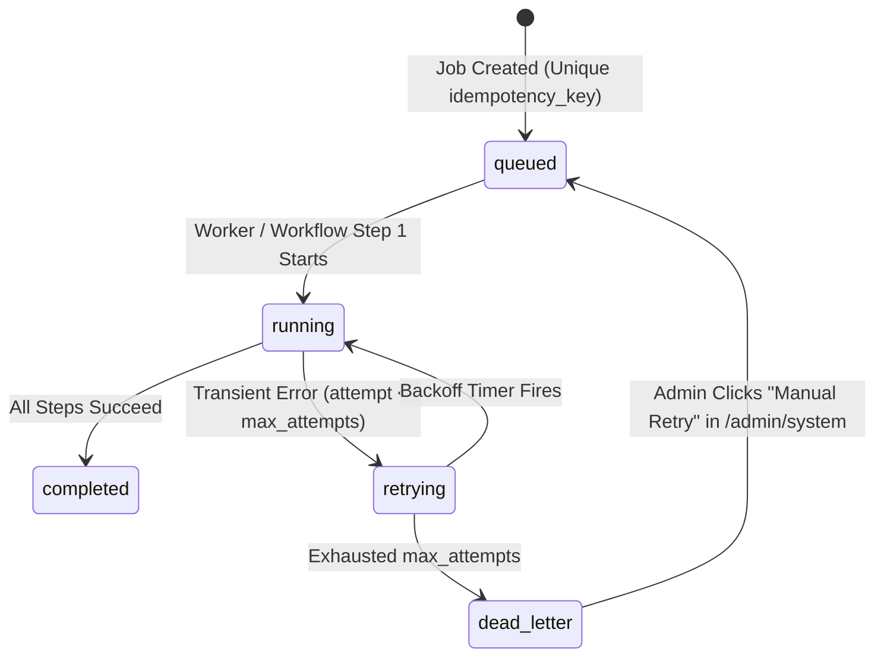

# 14 — Automation & Background Jobs Architecture

**Execution Engine:** Cloudflare Workflows + Cloudflare Queues + Cloudflare Cron Triggers  
**State & Audit Ledger:** Cloudflare D1 (`automation_jobs`, `automation_logs`, `scheduled_tasks`, `notification_logs`)  
**Core Principle:** Deterministic automation is primary; AI is strictly an editorial assistant gated by mandatory human approval.

---

## 1. Taxonomy of Platform Automations

We classify every operational workflow into one of three strict governance tiers:

| Tier | Definition | Examples in Projukti Labs | Human Approval Required? |
|---|---|---|---|
| **Tier 1: Deterministic Operational Automation** | Rule-based, 100% predictable system tasks triggered by events or schedules. | Inquiry email dispatch, lead creation, cache invalidation, XML sitemap refresh, RSS generation, session/log pruning, scheduled D1 backup export. | **No** (Runs automatically with retry & alerting) |
| **Tier 2: Deterministic Quality & Security Auditing** | Automated inspection that scores or flags issues for Admin visibility. | Blog SEO & accessibility audit (missing `alt` text, broken links, meta length, duplicate slug), login brute-force alert, follow-up due reminders. | **No** (Flags issues; Admin decides remediation) |
| **Tier 3: AI-Assisted Content & Marketing Drafts** | Optional LLM-assisted generation of article outlines, meta descriptions, or social captions. | AI blog draft generation, SEO title/description suggestions, LinkedIn/Facebook post draft generation upon article publication. | **YES — Mandatory Human Editorial Approval before any public publishing** |

---

## 2. Complete Automation Catalog & Trigger Matrix

| Workflow / Job Name | Trigger Type | Source Event / Schedule | Execution Steps (`step.do`) | Failure & Retry Policy |
|---|---|---|---|---|
| **`InquiryNotificationWorkflow`** | Queue (`projukti-labs-jobs`) | `POST /api/v1/inquiries` or `/consultation-requests` | 1. Load inquiry & lead from D1. 2. Send client confirmation email. 3. Send Founder/Admin alert email. 4. Log delivery in `notification_logs`. | 3 retries per step (exponential backoff: 10s, 60s, 300s); failed messages route to DLQ + Admin Dashboard alert. |
| **`BlogPublishWorkflow`** | Cron (`*/5 * * * *`) or Admin Immediate Publish | `posts.status = 'scheduled' AND scheduled_for <= now` (requiring `approved_by_user_id IS NOT NULL`) | 1. Transition post `status = 'published'`, set `published_at`. 2. Revalidate `/blog`, `/blog/[slug]`, category/tag caches. 3. Regenerate `/sitemap.xml` & `/rss.xml` cache. 4. Generate social share draft JSON. 5. Record audit & automation logs. | 3 retries per step; idempotent via `idempotency_key = "publish_post_" + post.id + "_" + version`. |
| **`ContentSeoAuditWorkflow`** | Admin Action or Weekly Cron (`0 3 * * 0`) | `POST /api/v1/admin/posts/:id/seo-audit` or scheduled sweep | 1. Parse MDX AST. 2. Check `h1`/`h2` structure, word count, reading time. 3. Verify all `` tags have non-empty `alt` text. 4. `HEAD`-check external/internal links for `404` broken links. 5. Save score & actionable checklist in `posts.last_seo_audit_json`. | 2 retries; non-blocking to public traffic. |
| **`FollowUpReminderJob`** | Cron (`0 9 * * *` Asia/Dhaka) | Daily 09:00 BDT check of `follow_ups` & `leads.next_follow_up_at` | 1. Query pending follow-ups due within 24h. 2. Dispatch daily digest / reminder email to assigned Admin. 3. Record in `notification_logs`. | 2 retries; idempotent per `(lead_id, date)`. |
| **`SystemMaintenanceJob`** | Cron (`0 2 * * *` UTC) | Nightly housekeeping | 1. Delete expired/revoked `sessions` older than 7 days. 2. Prune `login_attempts` > 90 days & `automation_logs` > 60 days. 3. Clean up unconfirmed R2 uploads (`media_assets` orphan check > 24h). | 2 retries; logs row counts pruned. |

---

## 3. Job Lifecycle & Observability Contract (`automation_jobs`)

No background task is allowed to fail silently ("fire-and-forget" `Promise` without logging is banned). Every Queue message and Workflow instance tracks its lifecycle in D1 `automation_jobs`:

### Mandatory Reliability Fields (`automation_jobs` Table):
- `id`: ULID primary key.
- `job_type`: e.g., `'INQUIRY_NOTIFICATION' | 'BLOG_PUBLISH' | 'SEO_AUDIT' | 'FOLLOW_UP_REMINDER' | 'SYSTEM_MAINTENANCE'`.
- `idempotency_key`: Unique constraint preventing duplicate emails or duplicate state transitions if a Queue delivers a message twice.
- `status`: `'queued' | 'running' | 'completed' | 'failed' | 'dead_letter'`.
- `attempt_count` / `max_attempts`: Default `max_attempts = 3`.
- `payload_json` & `last_error`: Preserves full input payload and stack trace so an Admin can inspect failures in `/admin/system/automation` and click **Retry Job**.

