# 15 — Deployment, Environment & CI/CD Strategy

**Target Platform:** Cloudflare Workers + D1 + R2 + KV + Queues + Workflows  
**Primary Domain:** `projuktilabs.tech` (Assets CDN: `assets.projuktilabs.tech`)  
**Version Control & CI/CD:** GitHub + GitHub Actions  

---

## 1. Three-Tier Environment Isolation

To prevent development experiments or unverified migrations from impacting live client inquiries, three strictly isolated environments are defined:

| Environment | Purpose | Compute & URL | D1 Database | R2 Bucket | KV & Queues |
|---|---|---|---|---|---|
| **1. Local (`development`)** | Developer workstation coding, unit/integration testing, local POC | `localhost:3000` / `wrangler dev` | Local SQLite in `.wrangler/state/v3/d1` | Local R2 emulator (or isolated dev prefix) | Local emulator in `.wrangler/state` |
| **2. Preview / Staging (`preview`)** | Pull Request verification, E2E Playwright QA, migration rehearsal | `preview.projuktilabs.tech` (or `*-preview.workers.dev`) | `projukti_labs_db_preview` | `projukti-labs-assets-preview` | `projukti-labs-cache-preview` / `projukti-labs-jobs-preview` |
| **3. Production (`production`)** | Live commercial studio & agency platform | `https://projuktilabs.tech` | `projukti_labs_db` | `projukti-labs-assets` | `projukti-labs-cache` / `projukti-labs-jobs` |

*Note: All Cloudflare resource names above are proposed identifiers for Phase 02 provisioning; no live Cloudflare resources have been created in Phase 01.*

---

## 2. Proposed `wrangler.jsonc` Binding Architecture (For Phase 02 POC)

```jsonc
{
  "$schema": "node_modules/wrangler/config-schema.json",
  "name": "projukti-labs-web",
  "compatibility_date": "2026-11-01",
  "compatibility_flags": ["nodejs_compat"],
  "d1_databases": [
    {
      "binding": "DB",
      "database_name": "projukti_labs_db",
      "database_id": "<TO_BE_PROVISIONED_IN_PHASE_02>",
      "migrations_dir": "db/migrations"
    }
  ],
  "r2_buckets": [
    {
      "binding": "R2_BUCKET",
      "bucket_name": "projukti-labs-assets"
    }
  ],
  "kv_namespaces": [
    {
      "binding": "KV_CACHE",
      "id": "<TO_BE_PROVISIONED_IN_PHASE_02>"
    }
  ],
  "queues": {
    "producers": [
      {
        "binding": "JOBS_QUEUE",
        "queue": "projukti-labs-jobs"
      }
    ],
    "consumers": [
      {
        "queue": "projukti-labs-jobs",
        "max_batch_size": 10,
        "max_retries": 3,
        "dead_letter_queue": "projukti-labs-jobs-dlq"
      }
    ]
  },
  "triggers": {
    "crons": [
      "*/5 * * * *",
      "0 2 * * *",
      "0 3 * * *"
    ]
  }
}
```

### Required Secrets (Managed via `wrangler secret put`, Never Committed to Git):
- `AUTH_SECRET` — 32-byte high-entropy secret for session signing/encryption.
- `INTERNAL_AUTOMATION_SECRET` — Secret header token for internal workflow triggers.
- `TURNSTILE_SECRET_KEY` — Cloudflare Turnstile server-side verification key.
- `R2_ACCESS_KEY_ID` & `R2_SECRET_ACCESS_KEY` — S3 API credentials scoped strictly to `projukti-labs-assets` for `aws4fetch` presigned URL generation.
- `EMAIL_API_KEY` — Transactional email provider API key (e.g., Resend).

---

## 3. GitHub Actions CI/CD Pipeline

```mermaid
flowchart LR
    PR["1. Push / PR"] --> Gate1["2. pnpm install --frozen-lockfile\n+ tsc --noEmit + eslint"]
    Gate1 --> Gate2["3. Unit, Schema & API Tests\n(Vitest + Local D1)"]
    Gate2 --> Gate3["4. vinext / Worker Build\nValidation"]
    Gate3 --> Preview["5. Deploy to Preview\n(Preview D1 Migrations + Worker)"]
    Preview --> E2E["6. Playwright E2E &\nResponsive Viewport QA"]
    E2E --> Approval["7. Manual Founder Approval\n& Migration Safety Check"]
    Approval --> Backup["8. Record D1 Time Travel\nPre-Deploy Timestamp"]
    Backup --> ProdMig["9. Apply D1 Production\nMigrations"]
    ProdMig --> ProdDeploy["10. Deploy Production Worker\n& Run Health Check"]
```



---

## 4. Production Migration Safety & Rollback Protocol

1. **Backward-Compatible Schema Evolution (Expand-and-Contract):**
   - Never rename or drop an active column in the same deployment that updates Worker code (since Cloudflare Workers roll out globally over several seconds).
   - Step 1: Add nullable column / new table in Migration A + deploy code that handles both.
   - Step 2: Backfill data if needed.
   - Step 3: Remove legacy column in a subsequent release.
2. **Pre-Migration Time Travel Bookmark:**
   - Immediately before running `wrangler d1 migrations apply projukti_labs_db --remote`, the CI pipeline records the current UTC ISO timestamp (`wrangler d1 time-travel info projukti_labs_db`).
3. **Instant Rollback Procedure:**
   - **Application Code Rollback:** `wrangler rollback` instantly reverts the Cloudflare Worker to the previous immutable version ID in < 10 seconds.
   - **Database Rollback:** If a migration causes data corruption, run `wrangler d1 time-travel restore projukti_labs_db --timestamp="<PRE_MIGRATION_TIMESTAMP>"` (subject to the 10 restores / 10 min platform limit).

