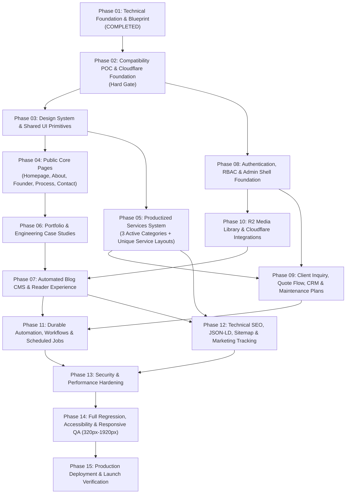

# 19 — Implementation Roadmap (Phases 01–15)

**Project:** Projukti Labs (`projuktilabs.tech`)  
**Execution Principle:** Dependency-aware incremental delivery. Every phase ends with a mandatory verification gate (Typecheck + Lint + Tests + Browser/Responsive QA + Security Check + Docs Update).

---

## 1. Phase Dependency Graph

---

## 2. Detailed Phase-by-Phase Execution Plan

### Phase 01 — Technical Foundation Planning (Current Phase — Completed)
- **Objectives:** Audit workspace, initialize Git & Next.js `16.4.5` baseline, validate Cloudflare + `vinext` + D1 + R2 architecture, and produce the 22-document engineering blueprint + `DESIGN.md`.
- **Completion Evidence:** All 22 documents in `docs/architecture/phase-01/` and root `DESIGN.md` reviewed and approved by Founder.

---

### Phase 02 — Compatibility POC & Project Foundation (Next Immediate Phase)
- **Objectives:** Execute the 17-point POC Test Plan (`18-technical-poc-test-plan.md`), lock the build adapter (`vinext` vs. `@opennextjs/cloudflare`), configure `wrangler.jsonc`, `drizzle.config.ts`, core D1 schema migrations, and seed script.
- **Dependencies:** Phase 01 Approval.
- **Deliverables:** Working `wrangler dev` pipeline, initial Drizzle schema & migration (`0000_initial_core_schema.sql`), idempotent seed script (`db/seeds/initial.ts`), `lib/db`, `lib/cloudflare`, and passing POC verification report.
- **Acceptance & Testing Gate:** `pnpm tsc --noEmit`, `pnpm lint`, Vitest D1 schema tests, and live local Worker boot passing all 17 POC checks.

---

### Phase 03 — Design System & Shared UI Foundation
- **Objectives:** Implement `DESIGN.md` tokens in `app/globals.css`, self-hosted variable fonts (`Geist`, `Geist Mono`, `Hind Siliguri`, `Caveat`), core accessible primitives (`Button`, `Card`, `Badge`, `Input`, `Select`, `Dialog`, `Tabs`, `Skeleton`), responsive layout shell (`Header`, `Footer`, app-like `MobileBottomNav`, `StickyMobileCTA`), and dark/light theme token support.
- **Dependencies:** Phase 02. (Can run in parallel with Phase 08 backend auth setup).
- **Acceptance & Testing Gate:** Playwright visual and accessibility check at `320px`, `375px`, `768px`, and `1440px`; zero horizontal overflow; WCAG AA contrast verified; `prefers-reduced-motion` honored.

---

### Phase 04 — Public Website Core Pages
- **Objectives:** Build bespoke page compositions for Homepage (`/`, powered by structured `page_sections`), About (`/about`), Founder Profile (`/founder` for Md Parvezul Islam), Our Process (`/process`), Pricing Overview (`/pricing` with BDT/USD toggle), FAQ (`/faq`), Legal pages (`/privacy-policy`, `/terms`), and custom `404`.
- **Dependencies:** Phase 03.
- **Acceptance & Testing Gate:** Dynamic D1 data rendering via `modules/cms`; Playwright desktop & mobile navigation tests; zero console or hydration errors.

---

### Phase 05 — Productized Services System (3 Active Categories + Unique Landing Pages)
- **Objectives:** Implement `modules/services` and the public `/services`, `/services/category/[slug]`, `/maintenance`, and `/services/[slug]` routes with **distinct layout compositions (`layout_variant`)**:
  - `pixel_funnel` (`/services/landing-page-facebook-pixel`)
  - `ecommerce_showcase` (`/services/complete-ecommerce-website`)
  - `web_conversion` (`/services/business-website`, `/services/portfolio-website`, `/services/corporate-website`, `/services/custom-website`, `/services/website-redesign`)
  - `maintenance_plans` (`/maintenance`, `/services/website-maintenance`)
  - Future 7 categories strictly rendered as `Coming Soon` / `Partner Supported`.
- **Dependencies:** Phase 03.
- **Acceptance & Testing Gate:** Verify each flagship service page renders its unique section architecture, package comparison table, deliverables vs. third-party exclusions, and mobile sticky CTA.

---

### Phase 06 — Portfolio & Engineering Case Studies
- **Objectives:** Implement `modules/portfolio`, `/portfolio`, `/portfolio/[slug]`, `/case-studies`, and `/case-studies/[slug]` with category/technology filtering, responsive device frame galleries, and MDX architecture case studies.
- **Dependencies:** Phase 04.
- **Acceptance & Testing Gate:** Filter interactions, MDX code block rendering, and mobile gallery swipe/scroll ergonomics verified in Playwright.

---

### Phase 07 — Automated Blog CMS & Reader Experience
- **Objectives:** Implement `modules/blog`, `/blog`, `/blog/[slug]`, `/blog/category/[slug]`, `/blog/tag/[slug]`, `/rss.xml`, table of contents generator, reading time calculator, bilingual (`en`/`bn`) typography support, and related posts engine.
- **Dependencies:** Phase 06, Phase 10 (Media).
- **Acceptance & Testing Gate:** Render English and Bangla technical articles with code highlighting, TOC anchor scrolling, and author cards.

---

### Phase 08 — Authentication, RBAC & Admin Foundation
- **Objectives:** Implement `modules/auth`, WebCrypto password hashing, `__Host-pl_session` HttpOnly cookies, `login_attempts` brute-force protection, 5 RBAC roles (`super_admin`, `admin`, `editor`, `manager`, `support`), `audit_logs`, `/admin/login`, and the protected `/admin/*` SaaS dashboard shell + Homepage Section Builder (`/admin/cms/homepage`).
- **Dependencies:** Phase 02.
- **Acceptance & Testing Gate:** Security tests for unauthenticated redirect, RBAC permission denial (`403`), brute-force lockout (`429`), CSRF check, and Homepage Section Builder live preview update.

---

### Phase 09 — Client Inquiry, Project Quote Flow, CRM & Maintenance Operations
- **Objectives:** Implement `/contact`, `/get-a-quote`, `/api/v1/inquiries`, `/api/v1/consultation-requests`, Turnstile bot verification, reference code status lookup (`/inquiries/status/[reference]`), and the Admin CRM pipeline (`/admin/inquiries`, `/admin/crm/leads` Kanban & detail view, notes, activities, follow-ups, clients, proposals, and maintenance support tickets).
- **Dependencies:** Phase 05, Phase 08.
- **Acceptance & Testing Gate:** Full user journey test: Visitor submits `/get-a-quote` → saved in `inquiries` & `leads` → visible in `/admin/crm/leads` → Admin updates stage & logs note → `audit_logs` & `lead_activities` updated.

---

### Phase 10 — Media Library & Cloudflare R2 / KV Integrations
- **Objectives:** Implement `modules/media`, `aws4fetch` presigned `PUT` upload flow (`/api/v1/admin/media/upload-url` & `/complete`), `env.R2_BUCKET.head()` validation, Admin Media Picker modal, and `lib/cache` (Cloudflare Cache API + KV invalidation).
- **Dependencies:** Phase 08.
- **Acceptance & Testing Gate:** Upload image in `/admin/media` → verify direct R2 `PUT` → attach to service/blog post → verify public rendering and cache invalidation.

---

### Phase 11 — Automation, Workflows & Background Jobs
- **Objectives:** Implement `InquiryNotificationWorkflow`, `BlogPublishWorkflow` (enforcing human `approved_by_user_id` gate), `ContentSeoAuditWorkflow`, `FollowUpReminderJob`, `SystemMaintenanceJob`, Email Adapter (`modules/notifications`), and `/admin/system/automation` monitoring UI with manual retry.
- **Dependencies:** Phase 07, Phase 09, Phase 10.
- **Acceptance & Testing Gate:** Test scheduled post publishing, SEO audit scoring (missing alt text / broken link detection), failed job retry, and idempotency protection.

---

### Phase 12 — SEO, Structured Data, Analytics & Marketing
- **Objectives:** Complete `modules/seo`, JSON-LD schemas (`Organization`, `Person`, `Service`, `TechArticle`, `BreadcrumbList`, `FAQPage`), dynamic `/sitemap.xml`, 301 `redirects` manager, Cloudflare Web Analytics, and configurable GTM / Meta Pixel + `event_id` deduplication.
- **Dependencies:** Phase 05, Phase 07.
- **Acceptance & Testing Gate:** Validate JSON-LD syntax, canonical tags, Open Graph previews, and Meta Pixel test event firing on inquiry submission.

---

### Phase 13 — Security & Performance Hardening
- **Objectives:** CSP & security headers audit, rate-limiting verification across all public mutations, SQL query `EXPLAIN QUERY PLAN` audit, bundle size optimization, and D1 backup/Time Travel recovery rehearsal.
- **Dependencies:** Phase 11, Phase 12.

---

### Phase 14 — Comprehensive QA, Accessibility & Responsive Verification
- **Objectives:** Execute full Playwright E2E regression across all 10 Mandatory User Journeys (Blueprint Section 18) and the complete viewport matrix (`320px`, `375px`, `390px`, `430px`, `768px`, `1024px`, `1280px`, `1440px`, `1920px`).
- **Dependencies:** Phase 13.

---

### Phase 15 — Production Deployment & Launch Verification
- **Objectives:** Provision production Cloudflare resources (`projukti-labs-web`, `projukti_labs_db`, `projukti-labs-assets`, `projukti-labs-cache`, `projukti-labs-jobs`), configure GitHub Actions CI/CD, execute production D1 migrations & seed, bind custom domain `projuktilabs.tech`, and run post-launch smoke & monitoring checks.
- **Dependencies:** Phase 14 + Founder Final Sign-off.

